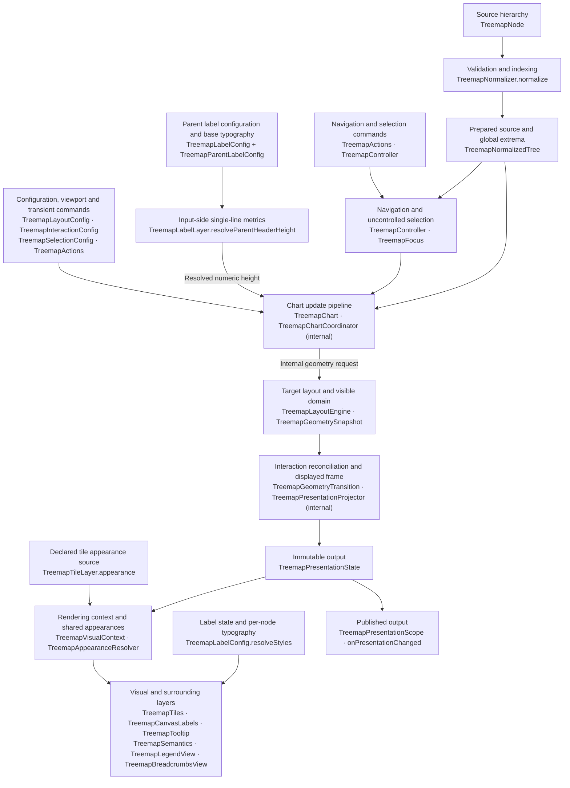

# any_treemap

[](https://github.com/andry-brill/a-treemap/actions/workflows/ci.yml)

A composable Flutter treemap for immutable hierarchical data. It separates data, geometry, interaction, and presentation so an application can use the included Material-oriented layers, replace only one layer, or consume the layout engine without rendering a chart.

The package includes eight layout algorithms, branch-specific layout rules, responsive aggregation, typed selection and navigation, keyboard support, color scales, legends, breadcrumbs, tooltips, canvas or widget labels, and keyed geometry transitions.


> You might also like my other packages: [any_timeago](https://pub.dev/packages/any_timeago), [any_sparklines](https://pub.dev/packages/any_sparklines), and [any_borders](https://pub.dev/packages/any_borders).

## Requirements and installation

`any_treemap` requires Dart 3.8 or later and Flutter 3.32 or later.

```console
flutter pub add any_treemap
```

Import the single public library:

```dart
import 'package:any_treemap/any_treemap.dart';
```

## Example playground


Run the shared playground from `example`:

```console
flutter pub get
flutter run -d chrome
```

The **Example** chooser loads one of 59 named presets. **Data** selects a shared dataset, and the property panel controls layout, colors, visual layers, interaction, accessibility, animation, and preview dimensions. Property info buttons explain each setting. On narrow screens, open **Properties** from the toolbar.

Preset links contain only an example key, such as `?example=appearance-auto-visible`. Editing any property switches to **Custom** and puts the complete configuration, including `data`, in the URL. **Copy link** includes valid pending edits. Browser Back/Forward restores committed changes; navigation, current selection, hover, and tooltips remain temporary.

Automatic bounds appear as **Auto** and serialize as `auto`; the chart translates them to the library's infinity defaults. Custom builders and strategies are registered choices. Comparisons, category/opacity compositions, standalone legends, validation, and isolate execution use the same configuration model.

See [the playground guide](example/README.md) for URL behavior and extension points, and [the feature matrix](example/FEATURES.md) for preset coverage.

## Quick start

A chart always needs a prepared hierarchy and a tile layer. Prepare it once when data changes and reuse it across builds. Colors are explicit: the package does not silently choose a palette or fallback color.

```dart
import 'package:any_treemap/any_treemap.dart';
import 'package:flutter/material.dart';

final root = TreemapNode<String>(
  key: 'products',
  label: 'Products',
  children: [
    TreemapNode(
      key: 'mobile',
      label: 'Mobile',
      weight: 55,
      color: 'mobile',
    ),
    TreemapNode(
      key: 'web',
      label: 'Web',
      weight: 30,
      color: 'web',
    ),
    TreemapNode(
      key: 'desktop',
      label: 'Desktop',
      weight: 15,
      color: 'desktop',
    ),
  ],
);

final scale = TreemapColorScale.exact(
  const {
    'mobile': Color(0xFF3F51B5),
    'web': Color(0xFF5C6BC0),
    'desktop': Color(0xFF9FA8DA),
  },
  fallback: const Color(0xFF607D8B),
);

final tree = TreemapNormalizer.normalize(root);
final appearance = TreemapAppearanceResolver<String>(colorScale: scale);

class ProductTreemap extends StatelessWidget {
  const ProductTreemap({super.key});

  @override
  Widget build(BuildContext context) {
    return SizedBox(
      width: 640,
      height: 400,
      child: TreemapChart<String>(
        tree: tree,
        tiles: TreemapTiles(appearance: appearance),
        labels: TreemapCanvasLabels(),
        tooltip: TreemapTooltip(
          builder: (context, details) => Text(
            '${details.label}: ${details.weight}',
            style: const TextStyle(color: Colors.white),
          ),
        ),
        layout: const TreemapLayoutConfig(
          innerSpacing: 3,
          outerPadding: TreemapInsets.all(8),
        ),
      ),
    );
  }
}
```

`TreemapChart` needs finite width and height. Put it in `SizedBox`, `Expanded`, or another bounded parent. A zero-sized chart or a hierarchy with no positive descendant weight produces `SizedBox.shrink`.

## Architecture

The rendering pipeline has four separate responsibilities:

1. `TreemapNode<K>` describes caller-owned data. `TreemapNormalizer` validates it and derives branch totals.
2. `TreemapLayoutEngine<K>` turns the hierarchy into a `TreemapGeometrySnapshot<K>` for a viewport and focus.
3. `TreemapChart<K>` resolves optional parent-label metrics from configuration and inherited typography before geometry, then computes layouts and owns immutable `TreemapPresentationState<K>` containing destination/displayed snapshots and color domains. The controller owns navigation and uncontrolled selection; the chart owns transient interaction.
4. Replaceable layers read `visual.presentation`; surrounding chrome reads `TreemapPresentationScope`. Presentation updates flow to consumers without writing layouts back to the controller.

This separation lets an application replace labels without reimplementing navigation, use the layout engine without constructing widgets, or change colors without changing geometry. Opt-in parent headers affect geometry through numeric sizing inputs; painting never writes measurements back into layout.



Source binding updates the controller's navigation and selection inputs. Computed layout, color domains and transient interaction stay downstream; commands start the next update through their owning handler.

## Data model

**`TreemapNode<K>`** - immutable, caller-owned source data for one hierarchy node. Stable identity is separate from every display value so updates, selection, navigation, and animation can survive label or weight changes.

- `key` - required globally unique domain identity. Prefer a database ID, enum, or stable path over display text.
- `weight` - non-negative finite leaf weight; defaults to `0`. A branch's effective weight is calculated from descendant leaves instead.
- `label` - optional human-readable title used by included presentation layers.
- `valueLabel` - optional preformatted display value for the standard canvas label layer; it never changes layout weight.
- `semanticLabel` - optional spoken label for the standard semantics layer.
- `color` - optional direct Flutter `Color` or input value for a configured `TreemapColorScale`.
- `data` - optional opaque application payload retained for builders and callbacks.
- `children` - immutable descendants; an empty iterable makes the node a source leaf.

The constructor copies `children` into an unmodifiable list. A direct `Color` bypasses scale lookup; another value is resolved through the scale; a null color input makes the included resolver use the resolved weight. Use `copyWith` for immutable updates and reuse keys across revisions so `resquarified` layout and transitions can preserve continuity.

**`TreemapNode.fromRecords<T, K>`** - builds an immutable hierarchy by grouping flat records through one or more record levels.

- `rootKey` - required stable key for the generated root.
- `records` - required source records; the method snapshots the iterable before grouping.
- `leafKey` - required mapper that produces a globally unique key for each leaf.
- `weight` - required mapper that produces each leaf's non-negative finite weight.
- `levels` - ordered `TreemapRecordLevel<T, K>` definitions, from the root grouping down to the leaf parent.
- `leafLabel` - optional visual-label mapper.
- `leafValueLabel` - optional preformatted-value mapper.
- `leafSemanticLabel` - optional accessibility-label mapper.
- `leafColor` - optional direct-color or color-scale-input mapper.
- `leafData` - optional payload mapper; the original record becomes the payload when this is absent.
- `rootLabel` - optional visual label for the generated root.

Grouping keys and leaf keys share one namespace. If a group name can repeat under different parents, include its ancestry in the generated key.

```dart
final root = TreemapNode.fromRecords<Sale, String>(
  rootKey: 'all-sales',
  rootLabel: 'All sales',
  records: sales,
  levels: [
    TreemapRecordLevel(
      key: (sale) => 'region:${sale.region}',
      label: (sale) => sale.region,
      color: (sale) => sale.region,
    ),
    TreemapRecordLevel(
      key: (sale) => 'team:${sale.region}:${sale.team}',
      label: (sale) => sale.team,
    ),
  ],
  leafKey: (sale) => 'sale:${sale.id}',
  leafLabel: (sale) => sale.product,
  weight: (sale) => sale.revenue,
  leafData: (sale) => sale,
);
```

**`TreemapRecordLevel<T, K>`** - describes one grouping step used by `TreemapNode.fromRecords`.

- `key` - required mapper that identifies a group.
- `label` - optional mapper for the group's visual label.
- `semanticLabel` - optional mapper for the group's accessibility label.
- `color` - optional mapper for the group's direct color or scale input.

The mappers receive the first record in a group. The class describes group nodes only; leaf values come from the separate `fromRecords` leaf mappers.

**`TreemapKey<K>`** - collision-free identity for either caller-owned data or a generated aggregate.

- `sourceKey` - the original `K` for a source identity; null for an aggregate identity.
- `aggregateParent` - parent identity used to scope a generated aggregate.
- `aggregateSignature` - generated membership signature; its presence marks the key as an aggregate.
- `isSource` - true when the key wraps caller data.
- `isAggregate` - true when the layout engine generated the identity.

Create domain identities with `TreemapKey.source(key)`. The layout engine creates `TreemapKey.aggregate` values when minimum-node aggregation combines siblings. Selection uses `TreemapKey<K>` so aggregates never need fake domain keys.

**`TreemapNormalizer.normalize<K>(root, {singleChildPolicy})`** - validates and prepares a source hierarchy, then derives the indexes needed by the layout engine.

- `root` - the immutable `TreemapNode<K>` hierarchy to validate and index.
- `singleChildPolicy` - `TreemapSingleChildPolicy.preserve` by default; `promote` replaces each non-root branch with exactly one source child by that child, including repeated chains.

Normalization validates the complete input before promotion and throws one `TreemapValidationException<K>` containing every detected issue. Preparation is iterative and linear in node count. Descendant totals and color extrema are calculated from the resulting hierarchy.

```dart
final tree = TreemapNormalizer.normalize(
  root,
  singleChildPolicy: TreemapSingleChildPolicy.promote,
);
```

For `All → [A → [Ten, Thirty], B → [Sixty]]`, promotion produces
`All → [A → [Ten, Thirty], Sixty]`. The container root and sibling order are
preserved. The promoted child retains its own key, weight, labels, color and
payload; parent metadata is discarded, even when the child's fields are null.
The input remains untouched. Eligibility counts all source children, including
zero-weight children, independently of viewport visibility and aggregation.

The returned tree contains only the resulting hierarchy. Removed keys have no
aliases or hidden ancestry; navigation, selection, breadcrumbs, parent/depth
layout rules and global color bounds all use the prepared nodes. Prepare again
when data or the promotion policy changes. In the playground, use **Data →
Single-child branches** or load `?example=data-single-child-promotion`.

**`TreemapNormalizedTree<K>`** - validated, indexed representation returned by `TreemapNormalizer`.

- `root` - prepared hierarchy root, retaining the supplied root's key and metadata.
- `nodes` - unmodifiable source-key-to-node index.
- `parents` - unmodifiable source-key-to-parent-key index; the root maps to null.
- `depths` - unmodifiable absolute source depth for every node.
- `globalColorDomain` - cached finite numeric extrema beneath the container root, using source colors or normalized weights.
- `totals` - unmodifiable effective-weight index; branch values are descendant sums.
- `pathTo(key)` - returns the immutable root-to-node source path, or an empty list when the key is absent.

Prepare with this class once when source data changes. Pass the resulting tree to charts, controllers, layout engines and standalone presentation; these consumers never normalize it again.

**`TreemapValidationIssue<K>`** - one actionable problem discovered while normalizing source data.

- `code` - typed `TreemapValidationCode`: `emptyKey`, `duplicateKey`, `cycle`, or `invalidWeight`.
- `key` - affected source key when one is available.
- `message` - explanation of the invalid input.
- `correction` - suggested way to repair it.

Issues are data rather than formatted UI, allowing an application to localize or regroup validation output.

**`TreemapValidationException<K>`** - collects every hierarchy issue found during one normalization pass.

- `issues` - immutable list of `TreemapValidationIssue<K>` values.

Catch this exception when records are user-generated and validation failures should be rendered in an application-specific way.

## Chart

**`TreemapChart<K>`** - orchestration widget that connects immutable data, layout, controller state, input, animation, and replaceable presentation layers.

- `tree` - required `TreemapNormalizedTree<K>`, prepared with `TreemapNormalizer.normalize(root)`.
- `tiles` - required complete tile-surface implementation; use `TreemapNoopTileLayer` for an intentionally invisible host.
- `controller` - optional externally owned controller. The chart creates and disposes an internal controller when omitted.
- `layout` - geometry configuration; defaults to a visual-neutral `TreemapLayoutConfig`.
- `labels` - optional label layer.
- `interaction` - pointer and keyboard policy; defaults to enabled built-in navigation.
- `selection` - optional controlled/uncontrolled selection policy.
- `tooltip` - optional tooltip layer.
- `surrounding` - optional single layer that composes breadcrumbs, legends, or other chrome around the viewport.
- `semantics` - optional accessibility layer; canvas paint has no semantics by itself.
- `transition` - optional keyed geometry animation; null applies updates immediately.
- `clipBehavior` - clipping for the chart stack; defaults to `Clip.none`.
- `autofocus` - whether the chart initially requests keyboard focus; defaults to false.
- `onPresentationChanged` - optional callback with immutable presentation output after the frame, including color-only changes and animation frames. Use it to update external legends or observers; keep source data stable unless it actually changes.

The chart requires finite width and height, caches recent layouts, hit-tests the deepest visible block, and binds navigation and selection when `tree` changes. The surrounding layer wraps the bounded viewport exactly once; tile, label, semantics, and tooltip layers share its geometry.

**`TreemapTransitionSpec`** - opt-in duration and curve for keyed chart geometry animation.

- `duration` - required transition duration.
- `curve` - required Flutter animation curve.

The chart interpolates bounds and opacity by `TreemapKey`. It overrides the configured duration with zero when `MediaQuery.disableAnimations` or accessible navigation requests reduced motion.

**`TreemapTransitions.standard`** - reusable transition preset for ordinary chart updates.

- `duration` - 300 milliseconds.
- `curve` - `Curves.easeInOutCubic`.

Pass this constant to `TreemapChart.transition`; leave `transition` null when updates should be immediate.

## Layout

**`TreemapLayoutConfig<K>`** - top-level geometry configuration for spacing, visible depth, minimum visible size, aggregation, and branch rule resolution.

- `policy` - `TreemapLayoutPolicy<K>` used to resolve a rule for each branch; defaults to the standard squarified policy.
- `outerPadding` - space removed from the viewport before root layout; defaults to zero.
- `levelPadding` - space removed inside every branch before laying out its children; defaults to zero.
- `innerSpacing` - gutter applied between sibling rectangles; defaults to `0`.
- `maxVisibleDepth` - maximum hierarchy levels below the current zoom focus; defaults to `null` (unlimited). `1` shows immediate children; `2` also shows grandchildren. Values must be positive or null.
- `minimumWidth` - minimum acceptable node width for hide/aggregate policies; defaults to `0`.
- `minimumHeight` - minimum acceptable node height for hide/aggregate policies; defaults to `0`.
- `minimumArea` - minimum acceptable node area for hide/aggregate policies; defaults to `0`.
- `minimumNodePolicy` - `show`, `hide`, or `aggregate`; defaults to `show`.
- `insufficientSpacePolicy` - behavior when every sibling fails its minimum: keep/aggregate, hide, or throw; defaults to `show`.

Padding and spacing affect geometry. Minimums affect which data is visible and can redistribute area, unlike layer-level `maximumNodes`, which only limits rendering.

Visible depth limits layout traversal while preserving the complete source tree and all descendant weights. A branch at the limit becomes a visible tile with its full total; it still has children and supports the existing drill-down interaction. The limit restarts after zooming or revealing an aggregate. Geometry depths, depth-based layout rules, and breadcrumb paths retain their existing absolute-depth semantics.

Use `layout.copyWith(maxVisibleDepth: 1)` to show one level, and `layout.copyWith(maxVisibleDepth: null)` to restore unlimited depth. Omitting the argument preserves the current value. Changing the limit preserves zoom focus and selection, and clears transient hover, tooltip, and keyboard targets that become hidden. Existing transition settings also apply to depth changes.

```dart
const layout = TreemapLayoutConfig<String>(
  outerPadding: TreemapInsets.all(8),
  levelPadding: TreemapInsets.all(4),
  innerSpacing: 2,
  minimumWidth: 40,
  minimumHeight: 28,
  minimumNodePolicy: TreemapMinimumNodePolicy.aggregate,
  insufficientSpacePolicy: TreemapInsufficientSpacePolicy.show,
);
```

**`TreemapLayoutAlgorithm`** - built-in strategy selected by a resolved layout rule.

- `squarified` - produces compact rectangles close to square; the general-purpose default.
- `resquarified` - reuses previous keyed topology during updates to reduce reordering.
- `slice` - divides height into horizontal slices.
- `dice` - divides width into vertical slices.
- `alternatingSliceDice` - alternates slice and dice by absolute tree depth.
- `strip` - builds ordered strips while improving their aspect ratios.
- `binaryByWeight` - recursively partitions siblings into groups with similar total weight.
- `binaryByCount` - recursively partitions siblings into groups with similar item counts.

Stable keys and a previous snapshot are especially important for `resquarified`; the other strategies do not require previous geometry.

**`TreemapLayoutRule<K>`** - partial branch rule whose null choices inherit from a resolved fallback.

- `algorithm` - optional built-in layout algorithm.
- `sort` - optional `sourceOrder`, `ascending`, `descending`, or `custom` sibling ordering.
- `comparator` - comparator used when `sort` is `custom`.
- `direction` - optional starting corner: top-left, top-right, bottom-left, or bottom-right.
- `axisOrder` - optional horizontal-first or vertical-first preference.
- `strategy` - optional custom `ITreemapLayoutStrategy<K>` that replaces the built-in algorithm for the branch.

Call `resolve` with an optional fallback to produce a complete `TreemapResolvedLayoutRule<K>`. Layout direction is independent of Flutter `TextDirection`.

**`TreemapResolvedLayoutRule<K>`** - complete non-null choices consumed by the layout engine after inheritance.

- `algorithm` - selected built-in algorithm.
- `sort` - selected sibling sort policy.
- `comparator` - optional custom comparator.
- `direction` - selected starting corner.
- `axisOrder` - selected primary-axis preference.
- `strategy` - optional custom strategy, which takes precedence over the built-in algorithm.

`TreemapResolvedLayoutRule.defaults()` produces squarified, descending, top-left, horizontal-first behavior.

**`TreemapLayoutPolicy<K>`** - resolves different rules for different branches without requiring separate charts.

- `rootRule` - base partial rule; omitted values resolve against package defaults.
- `byChildDepth` - partial rules keyed by the absolute depth of the children being placed.
- `byParentKey` - partial rules keyed by the source parent.
- `resolver` - optional callback for data- or bounds-dependent choices.
- `inheritResolvedRule` - whether a branch starts with its parent's resolved rule; defaults to true.

Resolution overlays depth, parent, and callback rules in that order. Set `inheritResolvedRule` to false when each branch should restart from `rootRule`.

```dart
final layout = TreemapLayoutConfig<String>(
  policy: TreemapLayoutPolicy(
    rootRule: const TreemapLayoutRule(
      algorithm: TreemapLayoutAlgorithm.squarified,
      sort: TreemapSortPolicy.descending,
    ),
    byChildDepth: const {
      2: TreemapLayoutRule(
        algorithm: TreemapLayoutAlgorithm.alternatingSliceDice,
      ),
    },
    resolver: (context) => context.children.length > 40
        ? const TreemapLayoutRule(
            algorithm: TreemapLayoutAlgorithm.binaryByWeight,
          )
        : null,
  ),
);
```

**`TreemapLayoutContext<K>`** - read-only branch state passed to `TreemapLayoutPolicy.resolver`.

- `parent` - source node whose immediate children are being partitioned.
- `children` - immutable immediate-child list.
- `childDepth` - absolute depth assigned to those children.
- `bounds` - rectangle available to the branch before sibling partitioning.
- `focusKey` - current source or aggregate focus identity.
- `inheritedRule` - complete rule inherited from the parent branch.

Use this context to select a rule from local structure without reaching into mutable engine state.

**`ITreemapLayoutStrategy<K>.layout(input)`** - extension contract for laying out one level of immediate siblings.

- `input` - immutable `TreemapStrategyInput<K>` containing sibling items and their available rectangle.
- return value - one `TreemapBounds` for every input `TreemapKey<K>`.

The engine still owns hierarchy traversal, rule resolution, spacing, minimum-node handling, focus, diagnostics, and snapshot creation.

**`TreemapStrategyInput<K>`** - complete input supplied to a custom immediate-children strategy.

- `items` - immutable `TreemapLayoutItem<K>` siblings in already-resolved order.
- `bounds` - rectangle the strategy must partition.
- `childDepth` - absolute depth of the items.
- `axisOrder` - preferred first axis selected by the resolved rule.

A strategy should remain deterministic and return finite, contained, non-overlapping rectangles.

**`TreemapLayoutItem<K>`** - layout-safe representation of one source or generated sibling.

- `key` - source or aggregate identity that must appear in the strategy result.
- `node` - source node, or null for a generated aggregate item.
- `weight` - resolved effective weight used to assign relative area.
- `sourceIndex` - stable pre-sort position from the source hierarchy.

Custom strategies should use `key` rather than assuming every item has a source node.

**`TreemapLayoutEngine<K>.layout`** - synchronous, deterministic conversion from hierarchy data to immutable geometry.

- `tree` - required prepared source hierarchy.
- `viewport` - required finite, non-negative output bounds.
- `config` - optional geometry configuration.
- `focus` - optional source branch or aggregate members to use as the viewport root.
- `previous` - optional prior snapshot used by topology-stable layout and transitions.

The method reads the prepared indexes, validates configuration, traverses branches iteratively, validates its output geometry, and throws typed validation or layout exceptions on invalid input.

**`TreemapLayoutEngine<K>.layoutAsync`** - isolate-backed version of `layout` for large sendable inputs.

- `tree` - required isolate-sendable prepared hierarchy.
- `viewport` - required output bounds.
- `config` - optional isolate-sendable configuration.
- `focus` - optional focus.
- `previous` - optional previous snapshot.
- `fallbackToSynchronous` - retries on the calling isolate when isolate execution fails; defaults to true.

Keys, payloads, callbacks, strategies, and configuration captured by the request must be isolate-sendable. Set `fallbackToSynchronous: false` when an isolate failure must be surfaced rather than retried.

```dart
final snapshot = await TreemapLayoutEngine<String>().layoutAsync(
  tree: tree,
  viewport: const TreemapBounds.fromLTWH(0, 0, 1200, 800),
  config: layout,
);
```

**`TreemapFocus<K>`** - identifies the source branch or generated aggregate whose children should fill the viewport.

- `key` - source or aggregate focus identity.
- `aggregateMembers` - source members represented by an aggregate focus; empty for source focus.
- `path` - navigation path retained for an aggregate focus.

Use `TreemapFocus.source(key)` for domain branches. `TreemapController.revealAggregate` constructs aggregate focus state during interactive navigation.

**`TreemapLayoutException`** - reports invalid layout configuration, insufficient configured space, or invalid generated geometry.

- `message` - human-readable failure explanation.

This exception covers geometry and configuration failures; source hierarchy failures use `TreemapValidationException<K>`.

## Geometry and callback data

**`TreemapInsets`** - Flutter-independent edge distances used by the pure layout engine.

- `left` - left inset.
- `top` - top inset.
- `right` - right inset.
- `bottom` - bottom inset.
- `horizontal` - derived sum of left and right.
- `vertical` - derived sum of top and bottom.

Construct uniform values with `TreemapInsets.all`, paired values with `TreemapInsets.symmetric`, or individual values with `TreemapInsets.fromLTRB`. `TreemapInsets.zero` is the visual-neutral default.

**`TreemapBounds`** - immutable, axis-aligned rectangle used for layout, hit testing, positioning, diagnostics, and transitions.

- `left` - x-coordinate of the left edge.
- `top` - y-coordinate of the top edge.
- `width` - horizontal extent.
- `height` - vertical extent.
- `right`, `bottom`, `area`, `centerX`, `centerY` - derived geometry.
- `contains(x, y, {padding})` - point containment with optional expanded hit-test padding.
- `inset(insets)` - returns a rectangle reduced by `TreemapInsets`.
- `inflate(value)` - returns a rectangle expanded or contracted on every edge.
- `clampTo(container)` - confines the rectangle to another rectangle.
- `overlaps(other, {tolerance})` - tests positive-area overlap.
- `lerp(a, b, t)` - linearly interpolates two rectangles.

Use `TreemapBounds.fromLTWH` for a concrete rectangle and `TreemapBounds.zero` for an empty origin rectangle. The type intentionally does not depend on Flutter's `Rect`.

**`TreemapGeometryNode<K>`** - resolved rectangle and hierarchy metadata for one source node or generated aggregate.

- `key` - source or aggregate geometry identity.
- `node` - original source node; null for a generated aggregate.
- `bounds` - resolved rectangle.
- `weight` - effective source or combined aggregate weight.
- `depth` - absolute hierarchy depth.
- `kind` - `TreemapGeometryKind.source` or `.aggregate`.
- `label` - retained source label; aggregates leave naming to presentation.
- `parentKey` - parent geometry identity, or null for top-level visible geometry.
- `opacity` - transition visibility from `0` to `1`.
- `aggregateMembers` - immutable source nodes represented by an aggregate.
- `hasChildren` - true for a source branch or revealable aggregate.

A geometry node is layout output, not caller data. Use `node` and `aggregateMembers` to get back to the application model.

**`TreemapPathEntry<K>`** - lightweight entry in the root-to-focus or root-to-node navigation path.

- `key` - source or aggregate identity.
- `label` - optional display label.
- `depth` - absolute hierarchy depth.

Breadcrumbs consume these entries without retaining the complete source tree.

**`TreemapGeometrySnapshot<K>`** - complete immutable output of one layout pass.

- `viewport` - bounds used for the pass.
- `nodes` - every source and aggregate geometry node, including visible ancestors.
- `index` - unmodifiable key-to-geometry lookup.
- `path` - current focus path.
- `focusKey` - source or aggregate identity filling the viewport.
- `revision` - monotonically increasing engine-local pass number.
- `visibleNodes` - nodes with positive opacity and non-empty bounds.
- `hitTest(x, y, {padding})` - deepest visible node containing a point.
- `toStringDeep({maximumNodes})` - bounded diagnostic dump.

Tile layers use visible geometry to paint hierarchy. Labels normally target `visual.presentation.visibleLeafNodes`; opt-in parent labels occupy reserved header regions. Semantics exposes visible nodes, and pointer hit testing selects the deepest rectangle at the pointer.

**`TreemapNodeDetails<K>`** - application-facing callback and builder view that combines geometry with a complete navigation path.

- `geometry` - underlying `TreemapGeometryNode<K>`.
- `path` - immutable root-to-node path.
- `key`, `bounds`, `headerBounds`, `weight`, `depth`, `label` - convenient geometry projections. `bounds` always describes the full tile; nullable `headerBounds` describes its reserved parent-label region.
- `node` - original source node when this is source geometry.
- `color` - source node's direct color or scale input.
- `aggregateMembers` - source members for generated aggregate geometry.
- `isAggregate` - whether the layout generated this block.
- `hasChildren` - whether activation can drill into a branch or reveal an aggregate.

The class deliberately does not synthesize labels, values, or colors. Builders decide how missing labels and aggregate nodes should look.

**`TreemapGeometryIssue<K>`** - one invariant violation found in an existing geometry snapshot.

- `code` - `nonFinite`, `negativeSize`, `outsideParent`, `overlap`, `duplicateKey`, or `invalidParent`.
- `message` - diagnostic explanation.
- `key` - affected geometry identity when available.

Geometry issues are returned as data so tests and developer tools can report more than one problem.

**`TreemapGeometryDiagnostics.validate<K>(snapshot, {tolerance})`** - validates identity, finiteness, containment, and sibling overlap.

- `snapshot` - geometry to inspect.
- `tolerance` - floating-point tolerance used for size, containment, and overlap checks; defaults to `1e-7`.
- return value - immutable list of `TreemapGeometryIssue<K>` values; an empty list means the snapshot passed.

Use this function when testing a custom layout strategy or geometry transformation. `TreemapLayoutEngine` already validates snapshots it produces.

**`TreemapGeometryTransition.lerp<K>(from, to, t)`** - lower-level keyed interpolation used by chart transitions.

- `from` - starting snapshot.
- `to` - target snapshot.
- `t` - interpolation fraction; values at or below `0` return `from`, and values at or above `1` return `to`.

Surviving keys interpolate their rectangles and opacity. Entering or exiting keys expand from or collapse toward their parent or viewport anchor.

## Presentation contracts and context

**`TreemapTileLayer<K>`** - required contract owning tile rendering and its shared background source.

- `appearance` - nullable `TreemapAppearanceResolver<K>` getter declaring the background source before any layer builds. Every implementation supplies this getter; wrappers can delegate to their tile layer. Return `null` when no shared source is needed. Canvas labels require a non-null source.
- `build(context, visual)` - returns a widget filling the chart viewport. `context` supplies inherited theme, locale and application state; `visual` supplies immutable presentation, keyed actions and inherited environment.

A tile layer may render source ancestors as well as deepest blocks. `TreemapChart` requires this contract but does not require a particular painter.
The chart reads `tiles.appearance` directly and passes it to viewport and surrounding
rendering contexts. This getter must not depend on `build` having run. Geometry and
published presentation remain free of styling objects.

**`TreemapLabelLayer<K>`** - optional chart layer owning parent-header sizing and label rendering.

- `resolveParentHeaderHeight(context)` - required method returning a finite, non-negative total header height, or `null` to disable reserved headers. Every custom layer implements it; wrappers may delegate. The chart calls it before geometry using configuration and inherited text metrics, without presentation output or rendering callbacks.
- `build(context, visual)` - returns a label surface filling the chart viewport. `context` supplies the Flutter build context and `visual` supplies the current immutable presentation. Rendering happens after geometry is resolved.

Label implementations normally iterate `visual.presentation.visibleLeafNodes`. Opt-in parent headers additionally use the reserved `headerBounds` from the same immutable geometry, excluding header-owning nodes from ordinary leaf labels.

**`TreemapSemanticsLayer<K>.build(context, visual)`** - optional contract for exposing canvas-rendered nodes to assistive technology.

- `context` - Flutter build context.
- `visual` - current geometry, node details, interaction state, and activation callbacks.
- return value - semantics surface filling the viewport.

Canvas paint does not create Flutter semantics automatically. Supply this layer whenever the chart must be accessible.

**`TreemapTooltipLayer<K>`** - optional contract owning tooltip activation preferences, lifecycle, and output.

- `activation` - hover, tap, or combined activation policy.
- `hideDelay` - optional delay before a tapped tooltip is hidden.
- `suppressDuringAnimation` - whether tooltips disappear while geometry is moving.
- `build(context, tooltip)` - builds the complete positioned tooltip output.

The chart identifies and tracks the target; the layer decides how it is represented.

**`TreemapSurroundingLayer<K>.wrap(context, treemap, visual)`** - optional chart contract for composing chrome around the bounded viewport.

- `context` - Flutter build context.
- `treemap` - already-built chart viewport.
- `visual` - shared presentation, keyed actions and inherited environment.
- return value - widget containing the viewport and surrounding content.

The chart applies one surrounding layer. Breadcrumbs and legends implement this contract for direct one-sided placement, while `TreemapSurroundingGrid` combines multiple pieces of content under one layer.

**`TreemapSurroundingContent<K>.build(context, visual)`** - content contract for one grid cell.

- `TreemapSurroundingContent<K>.widget(child: ...)` adapts a static widget.
- `TreemapSurroundingContent<K>.builder(builder: ...)` adapts a
  `TreemapSurroundingContentBuilder<K>` callback that receives the shared
  visual context.
- `TreemapBreadcrumbs<K>` and `TreemapLegend<K>` implement both the content and layer contracts.

Custom content receives the same presentation and actions without implementing viewport composition itself.

**`TreemapVisualContext<K>`** carries the read-only presentation, keyed `actions`, `textDirection` and `textScaler` shared by visual implementations. `tileAppearance` is the optional source declared by the tile layer. `resolveTileAppearances(context)` resolves that source for labels or custom layers. Appearance ownership stays with tiles, including invisible tiles. `resolveAppearances(context, resolver)` remains available for layers with an independent paint source. Both share a frame- and build-context-scoped cache.

**`TreemapPresentationState<K>`** is the immutable output consumed by every layer and surrounding view:

- `targetSnapshot` is the destination layout, null before the first layout; `displayedSnapshot` is the painted frame and may include outgoing nodes.
- `focusKey`, `currentPath`, `canZoomOut` and `selectedEntries` describe effective navigation and selection.
- `hoveredKey`, `hoveredColor`, `keyboardFocusedKey` and `tooltipKey` describe valid target interaction. Hover colors use source input or normalized weight. Hidden targets are cleared and do not reappear without a new interaction.
- `details`, `targetDetails`, `states`, `statesFor(key)` and `visibleLeafNodes` provide cached geometry-derived presentation. `isAnimating` and `interactionEnabled` describe current behavior.
- `resolveColorScale(scale)` uses cached global or visible extrema; explicit/custom scales pass through unchanged.
- `TreemapPresentationState.fromData(tree: ..., targetSnapshot: ...)` uses the same projection outside a chart. Optional selected entries, hover/focus/tooltip keys, displayed snapshot and interaction/animation flags support custom hosts.

The prepared tree caches global extrema. The chart computes visible extrema only when its target changes; animation frames reuse the destination domain. Scales, prepared trees and previously delivered presentation values remain unchanged.

**`TreemapActions<K>`** exposes `activate(key, {zoomOutRequested})`, `hover(key)`, `focus(key)`, `select(key, {toggle})`, `setSelection(keys)`, `clearSelection()`, `zoomTo(sourceKey)`, `zoomOut()`, `reset()` and `revealAggregate(key)`. Keys resolve against the current source/target when commands execute. The interface exposes no mutable state or notifier.

**`TreemapPresentationScope.of<K>(context)`** subscribes to the nearest chart's immutable output; `maybeOf` returns null outside a scope. `actionsOf<K>(context)` obtains that chart's actions, and `maybeActionsOf` returns null when unavailable. Scope consumers and `onPresentationChanged` receive output after the frame. In-viewport layers use `visual.presentation` immediately.

Only source binding changes controller state during chart updates. Layout, domains, hover, keyboard focus, tooltip timers and animation belong to the chart coordinator. Visuals read presentation; actions enter the next update as commands.

For an external legend, store the chart's output in a `ValueNotifier` and rebuild just the consumer:

```dart
final output = ValueNotifier(TreemapPresentationState.fromData(tree: tree));

// On the chart:
// onPresentationChanged: (state) => output.value = state,

ValueListenableBuilder<TreemapPresentationState<String>>(
  valueListenable: output,
  builder: (context, state, _) => TreemapLegendView<String>(
    scale: scale,
    presentation: state,
    config: const TreemapLegendConfig.bar(),
  ),
);
// Dispose output with its owning widget.
```


**`TreemapTooltipContext<K>`** - current tooltip target plus the complete shared visual context.

- `details` - target node details.
- `visual` - same `TreemapVisualContext<K>` received by other layers.

This lets a custom tooltip inspect selection, animation state, text direction, or neighboring geometry without separate wiring.

## Included tile and label layers

**`TreemapTiles<K>`** - optimized canvas implementation of `TreemapTileLayer<K>` using the package's appearance system.

- `appearance` - required `TreemapAppearanceResolver<K>` shared by tile and label presentation.

It resolves appearance for every geometry node and paints background, fills, gradients, borders, radii, opacity, and state styles in one custom-paint surface.

**`TreemapNoopTileLayer<K>`** - explicit invisible tile layer for geometry-only or interaction-only chart hosts.

- `appearance` - optional background source for labels and other consumers; it describes the background they should assume without painting it.
- `build(context, visual)` - returns an expanding empty widget, regardless of whether an appearance is declared.

Omit the source for geometry-only charts or arbitrary widget labels that do not
consume it. Canvas labels require a tile-owned source. The library never invents
a palette or paints rectangles on behalf of an invisible tile layer.

**`TreemapCompositeTileLayer<K>`** - stacks multiple independent tile layers over the same geometry.

- `layers` - immutable ordered layer list; earlier layers are below later layers.
- `appearance` - optional explicit background source shared with labels. No source is inferred from child order, even when there is only one child. Child layers keep their independent paint sources.

This is useful when a base painter, domain overlay, and debugging overlay should remain separate implementations.

**`TreemapBuilderTileLayer<K>`** - widget-per-deepest-block tile implementation for fully custom visual content.

- `appearance` - optional declared background source shared with labels; builders remain responsible for painting it.

- `builder` - required callback receiving context, node details, and visual states.
- `maximumNodes` - optional positive cap; the largest blocks are retained first.
- `ignorePointer` - whether generated widgets ignore input; defaults to false.

The layer supplies positioning but no clipping or styling. Choose it for images, embedded controls, platform views, or effects that genuinely need widgets.

**`TreemapCanvasLabels<K>`** - high-throughput text label layer using cached `TextPainter` layouts.

- `config` - formatting and layout policy; defaults to `TreemapLabelConfig<K>()`.

It clips every label independently, constrains text to available width, and omits a complete label block when it cannot fit vertically. Choose it for large charts whose labels are text.

Canvas labels automatically consume `TreemapTileLayer.appearance` for contrast, `colorResolver`
and custom `linesBuilder`. The standard tile painter and labels reuse the same
resolved map when built with the same context. Resolution is independent of
layer build order, respects each build context's inherited environment, and
refreshes on subsequent frames. Automatic parent-header metrics still depend
only on base label styles.

Custom widget backgrounds cannot be inferred. Declare the source on the custom
tile layer, including `TreemapNoopTileLayer` when rendering over an external
background. Canvas labels have no appearance input. A missing tile source raises
an actionable error rather than guessing a color, even with explicit text colors.
A composite explicitly declares which source represents the background beneath
its labels; the library does not blend its children's paints or gradients.

```dart
// Ordinary chart: appearance is configured once, with tiles.
tiles: TreemapTiles(appearance: appearance),
labels: TreemapCanvasLabels(config: labelConfig),

// Invisible tiles describe the background without painting it:
tiles: TreemapNoopTileLayer<String>(appearance: backgroundAppearance),
labels: TreemapCanvasLabels(config: labelConfig),
```

Standalone compositions forward their tile layer's declared source to
`TreemapVisualContext(tileAppearance: tileLayer.appearance, ...)` before building
layers. Sources are never registered as a side effect of painting.
Custom widget labels may call `visual.resolveTileAppearances(context)` and use
the returned background with their color resolver. Arbitrary builders remain
responsible for applying their own colors.

**`TreemapWidgetLabels<K>`** - tightly positions an arbitrary widget inside every retained deepest visible block.

- `builder` - required callback receiving context, node details, and visual states.
- `config` - shared `TreemapLabelConfig<K>`. Automatic parent sizing reads its title/value styles, padding, spacing and text direction; builders apply these settings to their own widgets.
- `maximumNodes` - optional positive cap; largest blocks are retained first.
- `ignorePointer` - whether label widgets ignore input; defaults to true so chart gestures remain available.
- `clipBehavior` - per-block clipping; defaults to `Clip.hardEdge`.

Choose this layer for icons, badges, SVGs, images, animations, or rich compositions. Configure layout minimums when the custom content requires guaranteed usable space.

**`TreemapTextLayoutCache.layout`** - bounded cache operation for custom canvas label implementations.

- `text` - required line contents.
- `style` - required complete `TextStyle`.
- `maxWidth` - required layout width, bucketed in four-pixel increments for cache reuse.
- `maxLines` - required maximum line count.
- `direction` - required text direction.
- `scaler` - required text scaler.
- `locale` - optional locale.
- `ellipsis` - optional overflow marker.
- return value - laid-out `TextPainter` retained in a 256-entry least-recently-used cache.

`TreemapCanvasLabels` owns its own cache. Use this public cache only when building another canvas implementation that needs the same bounded reuse behavior.

## Appearance and color

### Parent labels and header geometry

Pass `parentLabels` to either included label layer to label expanded parents:

```dart
labels: TreemapCanvasLabels<String>(
  config: labelConfig.copyWith(spacing: 6),
  parentLabels: const TreemapParentLabelConfig(
    showTitle: true,
    showValue: true,
    // height: 56, // Optional total allocation, including padding and spacing.
  ),
),
```

**`TreemapParentLabelConfig`** has independent `showTitle` and `showValue`
flags (both default true) and nullable `height`. Omit `parentLabels`, or disable
both flags, to retain ordinary leaf-only labels without reserving header space.
`height` is the public option for the allocation; `copyWith(height: null)` restores
automatic sizing. Explicit heights must be finite and nonnegative; zero reserves
an empty header while allowing children to use the content area.

Automatic height is one nominal title line, one nominal value line (only for
enabled parts), `config.padding.vertical`, and `spacing` when both parts
are enabled. Spacing defaults to 0 and stays fixed in logical pixels as text
scaling changes. Text measurement respects configured font metrics, line-height
multipliers, locale and accessibility text scaling. Automatic parent
text uses one line per part, independently of child `maxLines`. Fixed-height
headers use the existing line limit within the allocation. Parent text reuses
formatters, colors, alignment, direction and overflow behavior; it defaults to
top-left placement. Custom canvas `linesBuilder` retains its existing precedence
and owns its content; it ignores `spacing` during painting and automatic
allocation. Provide an explicit height for additional custom lines.

Standard canvas labels insert a gap only between two nonempty title/value blocks,
after the complete title even when it wraps. Automatic header sizing uses the
visibility flags without calling formatters; if a formatter returns empty text,
the nominal allocation remains reserved but painting omits the gap. An explicit
header height already includes any gap and is never increased by spacing.

Both renderers size headers exclusively from base `TreemapLabelConfig.titleStyle`
and `valueStyle`. Label node callbacks and hover/selection/focus styles change
rendering but never resize the header. Measurement never calls resolvers, builders
or formatters. If the complete text block cannot fit vertically, it is omitted; children still use whatever content
area remains below the reserved header.

**`TreemapWidgetLabels`** accepts the same `parentLabels`, plus an optional
`parentBuilder` with the ordinary `(context, details, states)` signature. Without
it, the existing builder also renders parents. Widgets receive tight header
constraints and default clipping. `details.bounds` remains the full tile;
`details.headerBounds` identifies the header. The builder owns title/value
visibility, styling and padding; configuration does not inspect or rewrite its
widget tree.

Pass the same `TreemapLabelConfig` to either renderer through `config`. Widget
header sizing reads `config.titleStyle`, `config.valueStyle`, `config.padding`,
`config.spacing` and `config.textDirection`, with inherited locale and text scaling.
Builders apply `Padding(padding: labelConfig.padding, child: ...)`, apply the
styles and direction to their text, and insert their own
`SizedBox(height: labelConfig.spacing)` only when both parts are shown. Use that
same configuration for child and parent builders. Canvas-only `linesBuilder`
is not invoked by widget labels and does not suppress their spacing.

```dart
const labelConfig = TreemapLabelConfig<String>(
  titleStyle: TextStyle(fontSize: 16, fontWeight: FontWeight.w600),
  valueStyle: TextStyle(fontSize: 12),
  padding: EdgeInsets.all(6), // Explicit inset; the default is EdgeInsets.zero.
  spacing: 6,
);

final labels = TreemapWidgetLabels<String>(
  config: labelConfig,
  parentLabels: const TreemapParentLabelConfig(),
  builder: buildLabel, // Uses labelConfig styles, padding, direction and spacing.
);
```

For automatic widget allocations, `config.titleStyle` and `config.valueStyle`
describe the expected text, while `config.padding` describes its padding.
Defaults are a 12 px semibold title, 11 px value, zero spacing and zero padding.
Supply the styles used by your builder, or set an explicit total header height.
Widget builders call `labelConfig.resolveStyles(context, details, states)` to
apply configured interaction and node-specific typography. Those overrides affect
rendering only; base styles remain the automatic allocation budget.
Configuration never rewrites the widget tree; visibility, formatting and applying
padding remain the builder's responsibility.
The library adds no padding wrapper around custom widgets. Canvas labels apply
the same config padding to standard text and custom `linesBuilder` output.
Padding is shared by children and parent headers and stays fixed in logical
pixels as text scales. It changes automatic header height, while explicit header
height already includes it. Layout `levelPadding` remains separate.

When migrating, replace `TreemapStyle.labelPadding` and widget `parentPadding`
with `TreemapLabelConfig.padding`. Set `padding: EdgeInsets.all(6)` explicitly
to retain the previous default inset; otherwise labels now have no inset.

`maximumNodes` limits the combined parent/leaf label candidates by label-region
area; culling does not reclaim
reserved geometry. Widget tile builders retain their existing behavior.

**`TreemapLabelLayer.resolveParentHeaderHeight(BuildContext)`** reads configuration
and inherited metrics before layout, returning a number or null. Custom label
wrappers delegate this method when wrapping the included label layers.
It must not read presentation output or measure built widgets. The chart forwards
the number to its coordinator, which passes it in an internal geometry request
and includes it in layout caching. Null disables reserved headers. The caller's
`TreemapLayoutConfig` remains unchanged. Rendering remains downstream of
immutable geometry and never updates the controller or triggers a measurement loop.

Source branches eligible for expansion first apply `levelPadding`, then reserve
a top header strip and lay out children below it. The height includes label
padding and spacing; level padding is separate and applied once. It does not change a parent's weight
or its sibling allocation.

Public headless calls to `TreemapLayoutEngine.layout`, `layoutAsync`, and
`TreemapPresentationState.fromData` do not reserve parent headers. Header sizing
belongs to the chart's label configuration. Internally, only the resolved number
is passed to geometry, including isolate execution; text measurement and Flutter
objects stay on the UI side.

**`TreemapGeometryNode.headerBounds`** is null for ordinary terminal labels and
non-null (possibly empty) for reserved headers. It is retained even if child
filtering or exhausted space removes every descendant. Bounds are capped to the
available inset rectangle and participate in copying, diagnostics and transitions.
When no child area remains, the parent retains its data, total and drill-down
capability. Branches stopped by `maxVisibleDepth` and aggregate tiles retain
ordinary full-tile labels. The current root/focus is not given an extra wrapper.

**`TreemapAppearanceResolver<K>`** - converts source color data and visual states into the complete appearance consumed by standard tiles and canvas labels.

- `colorScale` - required scale for category, numeric, or missing color inputs.
- `style` - base and state-specific `TreemapStyle`; defaults to `TreemapStyle()`.
- `nodeStyleResolver` - optional final per-node override receiving build context, node details, and current visual states.
- `resolve(context, details, states, {resolvedScale})` - returns one complete `TreemapAppearance` or throws when neither a color nor gradient remains. Custom layers can pass a chart-resolved or standalone-resolved scale; standard tiles and labels do this automatically.

Resolution starts with a direct source `Color`, otherwise sends the source color value or resolved weight through `colorScale`. It then merges base, hovered, selected, focused, and node-specific appearances in that order.

**`TreemapAppearance`** - rectangle paint styling for one tile state or override layer.

- `color` - optional solid fill.
- `gradient` - optional gradient fill.
- `border` - border side; defaults to none.
- `borderRadius` - tile corner radius; defaults to zero.
- `opacity` - value from `0` to `1`; defaults to `1`.

`merge(other)` treats null/neutral values as absent overrides and multiplies opacity. This lets a hover appearance add a border without restating the base fill.

**`TreemapStyle`** - groups the chart-wide base appearance, interaction-state overrides and background.

- `backgroundColor` - canvas background behind geometry; defaults to transparent.
- `tileAppearance` - base override merged onto every scale-derived fill.
- `hoverAppearance` - override applied to hovered nodes; defaults to a two-pixel white border.
- `selectedAppearance` - override applied to selected nodes; defaults to a three-pixel amber border.
- `focusedAppearance` - override applied to the keyboard target; defaults to neutral.

The style is consumed by `TreemapAppearanceResolver`; it does not affect geometry spacing or minimum dimensions.

### Color scales

**`TreemapColorScale`** - abstract mapping from caller values to explicit colors and legend metadata.

- `colorFor(value)` - maps one value to a color.
- `legendEntries` - discrete values, ranges, or stops suitable for a legend.
- `isContinuous` - whether values form a continuous domain; defaults to false.
- `minimum` - optional continuous lower bound.
- `maximum` - optional continuous upper bound.

Every included factory requires an explicit fallback color. This ensures null, unknown, out-of-domain, or invalid input has application-selected behavior.

**`TreemapColorScale.exact / TreemapExactColorScale`** - exact value-to-color mapping for known categories or semantic values.

- `colors` - required value-to-color map, copied into an unmodifiable map.
- `labels` - optional value-to-legend-label map; missing labels use `toString()`.
- `fallback` - required color for unmapped values.

Legend entries preserve map iteration order and retain each exact value.

**`TreemapColorScale.categorical / TreemapCategoricalColorScale`** - deterministic distribution of arbitrary non-null values across a fixed palette.

- `colors` - required non-empty palette.
- `labels` - optional labels for palette positions.
- `fallback` - required color for null values.

The value hash selects a palette entry. Legend entries describe palette positions, not the categories encountered in a particular tree.

**`TreemapNumericColorRange`** - one numeric interval and its discrete appearance.

- `minimum` - inclusive lower bound.
- `maximum` - upper bound; exclusive except for the final range in a scale.
- `color` - color assigned within the interval.
- `label` - optional legend label; defaults to a generated minimum-maximum label.

Use several ranges for explicit bands such as low, medium, and high.

**`TreemapColorScale.numericRange / TreemapNumericRangeColorScale`** - maps numbers through ordered, non-overlapping intervals.

- `ranges` - interval list; copied and sorted by minimum.
- `fallback` - required color for non-numeric, non-finite, out-of-range, or gap values.

Construction rejects reversed, non-finite, or overlapping ranges. Its `minimum` and `maximum` come from the outer range bounds.

**`TreemapColorScale.interpolated / TreemapInterpolatedColorScale`** - continuous linear interpolation across two or more colors.

- `minimum` - lower domain bound; defaults to `double.negativeInfinity` to infer it from data.
- `maximum` - upper domain bound; defaults to `double.infinity` to infer it from data.
- `domainScope` - `TreemapColorDomainScope.global` by default, or `.visible` to use current visible tiles.
- `colors` - required list of at least two ordered color stops.
- `fallback` - required color for non-numeric or non-finite input.
- `labelFormatter` - formats legend stop values; defaults to one fractional digit.

Finite numeric input is clamped to the domain, then interpolated between adjacent stops. Legend entries are positioned evenly across the domain.

**`TreemapColorScale.saturation / TreemapSaturationColorScale`** - continuous numeric scale that varies one base hue's saturation.

- `minimum` - lower domain bound; defaults to `double.negativeInfinity` to infer it from data.
- `maximum` - upper domain bound; defaults to `double.infinity` to infer it from data.
- `domainScope` - `TreemapColorDomainScope.global` by default, or `.visible` to use current visible tiles.
- `color` - required base color whose hue and lightness are retained.
- `minimumSaturation` - saturation at the lower bound; defaults to `0.15`.
- `maximumSaturation` - saturation at the upper bound; defaults to `1`.
- `fallback` - required color for non-numeric or non-finite input.
- `labelFormatter` - formats the two endpoint labels.

Numeric input is clamped to the domain. Saturation values must remain in an ordered `0` to `1` range.

**Automatic continuous domains** - omit either bound independently on interpolated or saturation scales. For example, `minimum: 0` keeps a fixed lower bound while the upper bound follows data.

```dart
final scale = TreemapColorScale.interpolated(
  colors: const [Colors.blue, Colors.red],
  fallback: Colors.grey,
  domainScope: TreemapColorDomainScope.visible,
);
final appearance = TreemapAppearanceResolver<String>(colorScale: scale);

TreemapChart<String>(
  tree: tree,
  layout: const TreemapLayoutConfig(maxVisibleDepth: 1),
  tiles: TreemapTiles(appearance: appearance),
  labels: TreemapCanvasLabels(),
  surrounding: TreemapLegend(
    scale: scale,
    config: const TreemapLegendConfig.bar(),
  ),
);
```

- `global` includes every source branch and leaf beneath the container root, including hidden descendants. The root and generated aggregate tiles are excluded. Zoom, visible depth, and viewport changes preserve this domain; source updates recalculate it.
- `visible` includes every target tile with nonempty bounds and positive opacity, including ancestor backgrounds and generated aggregates. It follows focus-relative `maxVisibleDepth`, zoom, culling, aggregation, and viewport size. Transitions use the destination domain, excluding outgoing tiles.
- Each candidate contributes its finite numeric `color`, or its effective weight when `color` is absent. Branch weights are descendant totals; aggregates use their combined weights. Direct Flutter colors and nonnumeric/non-finite inputs do not contribute.
- Equal inferred bounds use the midpoint color and one legend entry. Values below or above that bound use the corresponding endpoint. If an inferred bound crosses a fixed bound, the domain collapses at the fixed bound.
- No eligible values produces fallback colors, null resolved bounds, and no legend entries. An empty continuous bar reserves its configured footprint.
- Both explicitly finite bounds must remain strictly increasing. NaN and the opposite infinity signs are rejected.

Scales remain immutable and can be shared across charts. The built-in layers resolve them automatically through `visual.presentation.resolveColorScale(scale)`. Custom layers can use that same method and pass its result as `resolvedScale` to the appearance resolver.

**`scale.resolveDomain(values)`** - resolves a standalone automatic scale from finite numeric inputs; explicit and custom scales pass through unchanged. For example:

```dart
final resolved = scale.resolveDomain([15, 30, 55]);
final color = resolved.colorFor(30);
final legend = TreemapLegendView<String>(
  scale: resolved,
  config: const TreemapLegendConfig.bar(),
);
```

A standalone legend can alternatively receive the automatic scale and its chart's `presentation` output. Inside a chart it reads `TreemapPresentationScope` automatically. Reading colors, legend entries, fractions, or samples directly from an unresolved automatic scale throws `StateError`; resolve it first.

**`TreemapLegendEntry`** - presentation-neutral metadata for one discrete value, numeric interval, or continuous stop.

- `label` - required display text.
- `color` - required representative color.
- `value` - optional exact value or continuous stop value.
- `minimum` - optional interval lower bound.
- `maximum` - optional interval upper bound.

`TreemapLegendView` consumes these entries, and custom legend implementations can use them without depending on a particular scale class.

**`treemapContrastingTextColor(color)`** - chooses black or white text from a background luminance threshold.

- `color` - background color to inspect.
- return value - opaque black for luminance above `0.42`, otherwise opaque white.

This is the default basis for canvas label color resolution.

**`treemapColorFraction(scale, value)`** - normalizes a numeric value within a continuous scale domain.

- `scale` - scale supplying minimum and maximum.
- `value` - candidate numeric value.
- return value - clamped fraction from `0` to `1`; returns `0` for non-numeric/non-finite values or scales without a domain, and `0.5` for a value matching a constant domain.

Bar legends use the fraction to position their current-value pointer.

**`treemapSampleScale(scale, {count})`** - produces colors for a custom discrete or continuous legend.

- `scale` - scale to sample.
- `count` - requested continuous sample count; defaults to `32` and produces at least two samples.
- return value - sampled domain colors, or existing legend-entry colors when the scale has no numeric domain.

Use a higher count for a smoother custom gradient at the cost of more color stops.

### Canvas labels

**`TreemapLabelConfig<K>`** - shared label configuration. Canvas labels apply its formatting, measurement, overflow and text-style policy. Widget labels read its title/value styles, padding, spacing and text direction for automatic header sizing; custom builders own rendering.

- `showTitle` - whether the built-in resolver emits a title line; defaults to true.
- `showValue` - whether the built-in resolver emits a value line; defaults to true.
- `titleFormatter` - optional complete title formatter receiving `TreemapNodeDetails<K>`.
- `valueFormatter` - optional locale-independent value formatter.
- `localizedValueFormatter` - optional formatter receiving node details and the inherited `Locale`.
- `fallbackTitle` - title used when neither a source label nor a source key is available, normally for an aggregate; defaults to `Other`.
- `weightFractionDigits` - decimal precision for non-integer default weights; defaults to `2`.
- `titleStyle` - base title style for both renderers and nominal automatic header metrics.
- `padding` - `EdgeInsets` shared by child labels and parent headers; defaults to `EdgeInsets.zero`. Canvas applies it to all lines; widget builders apply it themselves. Vertical padding contributes to automatic header height.
- `spacing` - finite, nonnegative gap in logical pixels between nonempty standard title/value blocks; defaults to 0. Shared by children and parent headers across canvas/widget labels, independent of text scaling, and ignored by custom canvas `linesBuilder` output.
- `valueStyle` - base value style for both renderers and nominal automatic header metrics.
- `valueColorOpacity` - opacity applied to the inferred value color; defaults to `0.82`.
- `colorResolver` - derives the base text color from resolved tile appearance.
- `linesBuilder` - optional `(details, appearance, locale, styles)` callback replacing built-in lines; receives resolved `TreemapLabelStyle` and owns its returned styles.
- `maxLines` - maximum lines per individual `TextPainter`; defaults to `1`.
- `overflow` - Flutter text overflow mode; defaults to ellipsis.
- `ellipsis` - non-empty ellipsis marker; defaults to `...`.
- `alignment` - position of the complete line block inside padded bounds; defaults to top-left.
- `textDirection` - optional explicit text direction; inherited direction is used when absent.

**`TreemapLabelStyle`** holds nullable `titleStyle` and `valueStyle` overrides.
`copyWith(titleStyle: null)` or `copyWith(valueStyle: null)` clears that override;
omitted arguments are preserved. It supports value equality and hashing.

`TreemapLabelConfig` also accepts `hoverStyle`, `selectedStyle`, `focusedStyle`,
and a final `nodeStyleResolver(context, details, states)` returning
`TreemapLabelStyle?`. Resolution is **base → hovered → selected → focused →
per-node**. Null results or null individual styles preserve the preceding value.
Each supplied `TextStyle` replaces the entire preceding style, without merging.
All four override fields support explicit null resets in `copyWith`.

`config.resolveStyles(context, details, states)` returns both styles populated,
without contrast fallback. Canvas layers resolve a local immutable style map
while building from presentation, then pass it to the painter. No styling objects
enter geometry or coordinator inputs. State, callback and inherited-context
changes repaint labels without changing the geometry cache key.
`resolveLines(details, appearance, locale, styles: resolvedStyles)` applies
formatters and automatic color fallback to standard lines. Explicit color or
foreground paint in the final style wins over contrast and value opacity.
Custom lines receive the same styles as their fourth argument, but retain control
of their output and bypass standard spacing and color fallback.

```dart
final labelConfig = TreemapLabelConfig<String>(
  titleStyle: const TextStyle(fontSize: 20, fontWeight: FontWeight.w600),
  valueStyle: const TextStyle(fontSize: 16),
  hoverStyle: const TreemapLabelStyle(titleStyle: TextStyle(fontSize: 18)),
  selectedStyle: const TreemapLabelStyle(valueStyle: TextStyle(color: Colors.red)),
  nodeStyleResolver: (context, details, states) => details.key.sourceKey == 'food'
      ? const TreemapLabelStyle(titleStyle: TextStyle(fontSize: 16, color: Colors.purple))
      : null,
);
// Inside a widget builder:
final styles = labelConfig.resolveStyles(context, details, states);
// Apply styles.titleStyle / styles.valueStyle to Text widgets, along with your
// own contrast fallback, visibility, formatting, padding and spacing.
```

Formatter precedence is localized formatter, ordinary value formatter, node `valueLabel`, then formatted weight. `linesBuilder` retains clipping, text scaling, cached measurement, alignment, and overflow while replacing the generated lines. A localized formatter requires a `Localizations` ancestor.

**`TreemapCanvasLabelLine`** - one complete styled line returned by a custom canvas `linesBuilder`.

- `text` - required text to measure and paint.
- `style` - required complete `TextStyle`.

Return an iterable of these values when text belongs on canvas but built-in title/value construction is too restrictive. Use `TreemapWidgetLabels` when the content itself must be a widget.

### Migrating labels and appearance to 3.0.0

Every custom `TreemapLabelLayer` must implement `resolveParentHeaderHeight(context)`
directly. Return `null` when no parent headers are needed, or forward
`delegate.resolveParentHeaderHeight(context)` from a wrapper. The separate sizing
provider interface has been removed without a compatibility alias. Keep sizing
independent of `build` and presentation output.

Remove appearance inputs from `TreemapCanvasLabels`. Every custom `TreemapTileLayer`
must implement the nullable `appearance` getter directly. Wrappers can forward
`delegate.appearance`; layers without a shared source return `null`. Widget
and composite tile layers declare their source with `appearance:`. Move any
previous label `fallbackAppearance` onto the tile layer instead, including
`TreemapNoopTileLayer(appearance: backgroundAppearance)` for invisible tiles.
The rendering context's `resolveTileAppearances` also no longer accepts a fallback.

Move normal `TreemapAppearance.titleStyle/valueStyle` into the base label config.
Move hover/selected/focused text overrides to the corresponding `TreemapLabelStyle`
fields, and split text overrides out of the rectangle `nodeStyleResolver` into
`TreemapLabelConfig.nodeStyleResolver`. Rectangle resolver signatures are unchanged.
Remove widget normal-style forwarding; both layers now use the same configuration.
Add the fourth `styles` parameter to custom `linesBuilder` callbacks, and supply
`styles:` when calling `resolveLines` directly. Larger overrides may be clipped
or cause complete canvas text-block omission inside the fixed allocation.

Playground links now use `labels.titleSize/valueSize` for base typography and
`labels.hover.titleSize/valueSize`, `labels.selected.titleSize/valueSize` and
`labels.focused.titleSize/valueSize` for state overrides. `labels.nodeStyle` selects
the final label callback. Obsolete `tiles.normal/hover/selected/focused.titleSize`
and `.valueSize` keys produce unknown-property notices; there are no aliases.

## Interaction, selection, and navigation

**`TreemapInteractionConfig<K>`** - pointer, keyboard, built-in behavior, and typed callback policy for a chart.

- `enabled` - master input switch; defaults to true. Disabled nodes receive `TreemapVisualState.disabled`.
- `enableBuiltInBehavior` - whether selection, tooltip activation, and navigation run after callbacks; defaults to true.
- `zoomOnNodeTap` - whether ordinary activation drills into branches and can zoom out from the deepest level; defaults to true.
- `selectOnNodeTap` - whether activation updates selection; defaults to false.
- `longPressDuration` - delay before the long-press callback; defaults to Flutter's `kLongPressTimeout`.
- `tapSlop` - maximum movement still treated as tap or long press; defaults to `kTouchSlop`.
- `hitTestPadding` - expansion around geometry during hit testing; defaults to `0`.
- `directionalCrossAxisWeight` - cross-axis cost used by spatial arrow-key traversal; defaults to `0.35`.
- `onNodeTap` - callback receiving the deepest activated node before built-in behavior.
- `onNodeLongPress` - callback receiving a long-pressed node.
- `onHoverChanged` - callback receiving the current node or null when hover exits.
- `onSelectionChanged` - callback receiving the complete next selection and changed node.
- `cursorResolver` - maps current hover details, or null, to a `MouseCursor`.

Activating a branch drills into it. Activating a deepest leaf with no custom `onNodeTap` zooms out. Holding Control, Meta, Alt, or Shift requests zoom-out instead. Arrow keys move spatially; Enter and Space activate; Escape and Backspace zoom out.

**`TreemapSelectionConfig<K>`** - controls ownership and tap behavior for node selection.

- `selected` - non-null immutable set means controlled selection; null delegates storage to `TreemapController`.
- `toggleable` - whether activating an already selected entry removes it; defaults to true.
- `allowMultiple` - whether activation retains earlier selected entries; defaults to false.
- `fallbackToNearestAncestor` - retained nearest-ancestor selection preference; defaults to false. The current chart selection path does not consume this flag.

Selection uses `TreemapKey<K>` rather than `K` so generated aggregate blocks can participate without masquerading as source data. In controlled mode, update application state from `onSelectionChanged`; the chart does not mutate the supplied set.

```dart
Set<TreemapKey<String>> selected = {
  const TreemapKey.source('mobile'),
};

TreemapChart<String>(
  tree: tree,
  tiles: TreemapTiles(appearance: appearance),
  selection: TreemapSelectionConfig(selected: selected),
  interaction: TreemapInteractionConfig(
    zoomOnNodeTap: false,
    selectOnNodeTap: true,
    onSelectionChanged: (next, changed) {
      setState(() => selected = next);
    },
  ),
)
```

**`TreemapController<K>`** - observable owner of drill-down focus, navigation path and uncontrolled selection against a prepared tree.

- `maximumSelections` - maximum programmatic selection count; defaults to `1`. Use null for no limit.
- `focusKey` - current source or aggregate focus identity.
- `currentPath` - immutable path to the current focus.
- `canZoomOut` - whether the current path has an ancestor.
- `selectedEntries` - immutable source and aggregate selection identities.
- `selectedKeys` - source-domain keys only; generated aggregate selections are excluded.
- `synchronize(tree, {notify})` - binds a prepared tree and reconciles navigation and uncontrolled selection; notifies by default. The chart suppresses notifications during input binding. It performs no normalization or presentation computation.
- `zoomTo(key)` - focuses a source branch.
- `zoomOut()` - focuses the previous path entry.
- `reset()` - focuses the source root.
- `revealAggregate(key, memberKeys: ...)` - focuses the source members represented by aggregate geometry.
- `select(key, {toggle})` - selects a source-domain key.
- `selectEntry(key, {toggle})` - selects a source or aggregate identity.
- `setSelection(keys)` - replaces uncontrolled selection while enforcing `maximumSelections`.
- `clearSelection()` - removes uncontrolled selection.

Supply a controller for application navigation and uncontrolled selection. Legends and breadcrumbs render presentation; custom chart content uses actions. Dispose a controller your widget creates; `TreemapChart` disposes only its own internal controller. On data updates, `synchronize` removes vanished selections, preserves surviving focus, and falls back to the nearest surviving ancestor.

```dart
class _DashboardState extends State<Dashboard> {
  final controller = TreemapController<String>(maximumSelections: 3);

  @override
  void dispose() {
    controller.dispose();
    super.dispose();
  }

  @override
  Widget build(BuildContext context) {
    return Column(
      children: [
        ListenableBuilder(
          listenable: controller,
          builder: (context, _) => Row(
            children: [
              FilledButton(
                onPressed: () => controller.zoomTo('products'),
                child: const Text('Products'),
              ),
              TextButton(
                onPressed: controller.canZoomOut ? controller.zoomOut : null,
                child: const Text('Back'),
              ),
            ],
          ),
        ),
        Expanded(
          child: TreemapChart<String>(
            tree: tree,
            controller: controller,
            tiles: TreemapTiles(appearance: appearance),
            surrounding: const TreemapBreadcrumbs(),
          ),
        ),
      ],
    );
  }
}
```

**`TreemapCommandResult<K>`** - typed outcome of a controller navigation command.

- `status` - `completed`, `unchanged`, `missingKey`, `leafCannotBeFocused`, or `noAncestor`.
- `key` - optional source or aggregate target identity.
- `message` - optional failure explanation.
- `succeeded` - true only for `completed`.

Normal navigation failures return this object rather than throwing, which makes toolbar feedback and disabled states straightforward.

## Tooltips

**`TreemapTooltip<K>`** - standard `TreemapTooltipLayer<K>` adapter combining content, lifecycle configuration, and positioned output.

- `builder` - required node widget builder for tooltip content.
- `config` - activation, placement, sizing, lifecycle, and shell configuration; defaults to `TreemapTooltipConfig()`.

The chart owns target tracking and calls this layer for the deepest visible block. Content and container builders are independent, so application data formatting does not need to recreate positioning or decoration.

**`TreemapTooltipConfig`** - behavior and presentation-shell policy for the standard tooltip layer.

- `activation` - `hover`, `tap`, or `hoverAndTap`; defaults to combined activation.
- `placement` - `auto`, `above`, `below`, `left`, or `right`; defaults to auto.
- `fitInside` - clamps tooltip position to viewport bounds; defaults to true.
- `hideDelay` - duration before a tapped tooltip hides; defaults to two seconds.
- `margin` - gap between tooltip and target rectangle; defaults to eight pixels.
- `maxWidth` - maximum content width; defaults to 280 pixels.
- `containerBuilder` - builds the complete shell around content; defaults to `TreemapTooltipContainer`.
- `suppressDuringAnimation` - hides the tooltip while geometry moves; defaults to true.

Auto placement prefers above when it fits and otherwise uses below. `fitInside` can alter that ideal position to keep the complete tooltip visible.

**`TreemapTooltipView<K>`** - standalone positioned tooltip widget for custom `Stack` compositions.

- `details` - target node and rectangle.
- `config` - placement, sizing, and shell policy.
- `builder` - content builder.

`TreemapTooltip<K>` creates this view automatically. Use it directly only when implementing a custom tooltip layer or external geometry composition.

**`TreemapTooltipContainer`** - reusable standard decorated shell around tooltip content.

- `child` - required content widget.
- `decoration` - background decoration; defaults to a dark translucent rounded box.
- `padding` - content inset; defaults to 12 horizontal and 8 vertical pixels.

Configure this widget from `TreemapTooltipConfig.containerBuilder` when only the standard shell's appearance should change.

## Surrounding grid

**`TreemapSurroundingGrid<K>`** - strict, direction-aware 3×3 composition whose center is always the treemap viewport.

- `topStart`, `topCenter`, `topEnd` - content in the top row.
- `middleStart`, `middleEnd` - side content beside the treemap.
- `bottomStart`, `bottomCenter`, `bottomEnd` - content in the bottom row.
- `padding` - inset around the complete grid; defaults to zero.
- `rowGap`, `columnGap` - nonnegative gaps between rows and cells; default to zero.
- `clipBehavior` - grid painting clip; defaults to `Clip.none`.

Slots accept `TreemapSurroundingContent<K>`, so built-in breadcrumbs and legends can be used directly. Use `TreemapSurroundingContent.widget` for an ordinary widget or `TreemapSurroundingContent.builder` when content needs chart presentation and actions.

**`TreemapSurroundingGrid.fromMap(content)`** - dynamic alternative to the named-slot constructor. The map associates `TreemapOverlayPosition` values with surrounding content and is read immediately rather than retained. Optional padding, gaps, and clipping have the same defaults as the named constructor.

The grid uses ordinary Flutter flex layout rather than measuring shared tracks. Populated top and bottom rows contain three equal-width logical cells, align content according to the slot name, and take the maximum natural height of their children. A lone `topCenter` or `bottomCenter` spans its full row, and empty top or bottom rows are omitted. The middle row receives the remaining height; its optional start and end widgets use their own widths and the treemap expands through everything left over. With no middle-side content, the treemap spans the full width.

Sizing and overflow belong to supplied content. Use `SizedBox` for a fixed row contribution, `ConstrainedBox` for bounds, and scrolling or text overflow inside the slot when necessary. For example, wrapping one top-row child in `SizedBox(height: 56)` makes that row at least 56 pixels high. If content cannot fit, Flutter's normal flex-overflow diagnostics apply; the grid does not compress or reject it with custom sizing errors.

Start and end resolve through ambient `Directionality`: they map to left and right in LTR and swap in RTL. Because rows and cells do not overlap, normal Flutter paint and hit-test order applies. `Clip.none` preserves ordinary overflow painting; other clip values wrap the composition in `ClipRect`.

## Breadcrumbs

**`TreemapBreadcrumbs<K>`** - presentation-driven surrounding content that can also place navigation breadcrumbs directly on one side of the chart.

- `config` - placement, overflow, builders, and wrapper configuration; defaults to `TreemapBreadcrumbsConfig<K>()`.

It implements both `TreemapSurroundingContent<K>` and `TreemapSurroundingLayer<K>` and creates `TreemapBreadcrumbsView<K>` with the chart's presentation and navigation actions. `config.position` controls direct layer placement; a `TreemapSurroundingGrid` slot controls placement when the breadcrumb is grid content.

**`TreemapBreadcrumbsView<K>`** - standalone breadcrumb widget that reads presentation and builds actionable ancestors.

- `presentation` - optional immutable output; otherwise reads the nearest scope.
- `onNavigate` - optional callback for ancestor activation. Without it, breadcrumbs are read-only.
- `config` - breadcrumb construction and overflow policy.

The current item has no navigation action. Ancestor items invoke `onNavigate`; built-in chart breadcrumbs send source-key navigation through chart actions. Generated aggregate entries retain their existing navigation semantics.

**`TreemapBreadcrumbsConfig<K>`** - complete construction and overflow policy for a breadcrumb row.

- `position` - directional grid cell; defaults to `topCenter`.
- `separatorBuilder` - builds a fresh separator between adjacent entries.
- `overflow` - `wrap`, `scroll`, or `ellipsis`; defaults to horizontal scrolling.
- `itemBuilder` - builds each complete item from context, path entry, current state, and optional action.
- `wrapperBuilder` - wraps the complete breadcrumb surface with layout or decoration.
- `ellipsisMaximumChildren` - positive number of trailing widgets retained in ellipsis mode; defaults to `5`.
- `overflowIndicatorBuilder` - builds the marker shown before retained content.

Builders own complete widgets, including semantics and interaction. The defaults compose `TreemapBreadcrumbItem`, `TreemapBreadcrumbSeparator`, and `TreemapOverlayContainer`.

**`TreemapBreadcrumbItem`** - standard accessible, animated breadcrumb item used by the default builder.

- `label` - required visible text.
- `isCurrent` - required current-level state.
- `onPressed` - ancestor navigation action; normally null for the current item.
- `semanticLabel` - optional spoken label replacing visible text.
- `animationDuration` - indicator animation duration; defaults to 180 milliseconds.
- `animationCurve` - indicator animation curve; defaults to linear.
- `indicatorColor` - current-level color; defaults to the theme primary color.
- `inactiveIndicatorColor` - ancestor indicator color; defaults to transparent.
- `indicatorWidth` - bottom indicator thickness; defaults to two pixels.
- `textStyle` - optional label style; defaults to theme body-medium.
- `maxLines` - positive label line limit; defaults to `1`.
- `overflow` - text overflow policy; defaults to ellipsis.
- `buttonStyle` - optional containing `TextButton` style.

The widget marks current items selected in semantics and ancestor items as buttons. Use it inside a custom `itemBuilder` to retain standard behavior with application-specific styling.

**`TreemapBreadcrumbSeparator`** - standard centered separator between adjacent breadcrumb items.

- `label` - separator text; defaults to `›`.
- `dimension` - square reserved extent; defaults to 16 pixels.
- `textStyle` - separator style; defaults to a compact 16-pixel style.

Use the config's separator builder to replace it with an icon or localized glyph.

## Legends

**`TreemapLegend<K>`** - surrounding content that can also place a color-scale legend directly around the chart and connects hover state when needed.

- `scale` - required scale supplying colors, entries, and optional continuous domain.
- `config` - required discrete or bar legend configuration.

It implements both surrounding contracts and creates `TreemapLegendView<K>`, which reads chart-owned presentation state. Its colors, labels, and pointer use the same destination domain and effective hover input as the tiles. `config.position` controls direct layer placement but is ignored in favor of the selected grid slot when used inside `TreemapSurroundingGrid`.

**`TreemapLegendView<K>`** - standalone legend renderer for use inside or outside a chart.

- `scale` - required color scale.
- `config` - required legend structure and builders.
- `presentation` - optional immutable chart output, normally obtained through `onPresentationChanged`. If omitted, the nearest `TreemapPresentationScope` is used.

Without presentation state, supply a finite or explicitly resolved scale. It renders colors and labels; supply presentation with a hovered target to enable its pointer.

**`TreemapLegendConfig.discrete`** - configures separate legend items for exact values, categories, or numeric ranges.

- `position` - directional grid cell; defaults to `bottomCenter`.
- `title` - optional title.
- `overflow` - wrap or scroll behavior; defaults to wrap.
- `direction` - item flow axis; defaults to horizontal.
- `wrapperBuilder` - complete legend shell builder.
- `spacing` - gap between title/items and individual runs; defaults to eight pixels.
- `semanticsLabel` - base spoken label; defaults to `Treemap legend`.
- `titleBuilder` - complete title builder.
- `labelBuilder` - builder for each entry label.
- `itemBuilder` - complete color-and-label item builder.
- `runSpacing` - cross-run gap in wrap mode; defaults to four pixels.

The default builders compose theme text, `TreemapLegendItem`, and `TreemapOverlayContainer`.

**`TreemapLegendConfig.bar`** - configures a continuous sampled or segmented color bar and optional hover pointer.

- `position` - directional grid cell; defaults to `bottomCenter`.
- `title` - optional title.
- `overflow` - surrounding overflow policy; defaults to scroll.
- `direction` - horizontal or vertical bar axis; defaults to horizontal.
- `wrapperBuilder` - complete legend shell builder.
- `spacing` - gap between title, bar, and related content; defaults to eight pixels.
- `semanticsLabel` - base spoken label; defaults to `Treemap legend`.
- `titleBuilder` - complete title builder.
- `labelBuilder` - endpoint label builder.
- `segmented` - uses legend-entry colors instead of continuous sampling; defaults to false.
- `barBuilder` - builds the complete bar from resolved colors and direction.
- `pointerBuilder` - builds the current-value marker from color and normalized fraction.
- `horizontalBarSize` - defaults to 160 by 20 pixels.
- `verticalBarSize` - defaults to 20 by 120 pixels.
- `pointerExtent` - main-axis pointer extent used for centering; defaults to 18 pixels.
- `horizontalPointerOffset` - distance the pointer extends above a horizontal bar; defaults to 16 pixels.
- `verticalPointerOffset` - distance the pointer extends left of a vertical bar; defaults to 18 pixels.
- `showLabels` - displays first and last scale labels; defaults to true.
- `sampleCount` - number of colors sampled from a continuous scale; defaults to `32`.

Use `segmented: true` for hard color bands. Continuous scales otherwise produce a smooth sampled bar.

**`TreemapLegendItem`** - standard discrete legend composition of a swatch and caller-built label.

- `color` - required swatch color.
- `label` - required label widget.
- `swatchSize` - square swatch extent; defaults to 12 pixels.
- `spacing` - horizontal gap before the label; defaults to four pixels.
- `swatchBorderRadius` - swatch corners; defaults to two pixels.
- `swatchBorder` - optional swatch border.

Configure it from a custom legend item builder when standard structure is suitable but sizing or decoration differs.

**`TreemapLegendBar`** - standard directional gradient used by bar legends.

- `colors` - required ordered list with at least two colors.
- `direction` - required axis; colors run left-to-right or bottom-to-top.
- `borderRadius` - bar corners; defaults to three pixels.
- `stops` - optional normalized position for each color; length must match `colors`.
- `tileMode` - gradient behavior outside its endpoints; defaults to clamp.

The legend config determines whether these colors came from continuous sampling or discrete segments.

**`TreemapLegendPointer`** - standard text-glyph marker for the current value on a color bar.

- `symbol` - marker glyph; defaults to `▼`.
- `dimension` - square reserved extent; defaults to 18 pixels.
- `color` - optional marker color; defaults to theme on-surface.
- `textStyle` - optional additional text styling.

The legend rotates this widget for vertical bars and positions it from `treemapColorFraction`.

## Shared overlay types

**`TreemapOverlayContainer`** - reusable shell for breadcrumb, legend, or other surrounding content.

- `child` - required overlay content.
- `padding` - inset around content; defaults to zero.
- `decoration` - optional background decoration.

Use it from wrapper builders to change standard padding or decoration without recreating layer composition.

**`TreemapOverlayPosition`** - one of eight direction-aware cells around the treemap.

- `topStart`, `topCenter`, `topEnd` - cells in the natural-height top row.
- `middleStart`, `middleEnd` - caller-sized cells beside the expanding treemap.
- `bottomStart`, `bottomCenter`, `bottomEnd` - cells in the natural-height bottom row.

A lone top or bottom center cell spans the full row. Start and end resolve through ambient `Directionality`.

**`TreemapOverflowMode`** - shared insufficient-space policy for breadcrumbs and legends.

- `wrap` - continues items on additional runs.
- `scroll` - exposes overflow through scrolling.
- `ellipsis` - retains a compact subset and marks omitted content.

Individual layers define which modes they support and how the compact subset is selected.

## Accessibility, locale, and visual state

**`TreemapSemantics<K>`** - standard accessibility layer for canvas-rendered treemap nodes.

- `labelResolver` - optional spoken-label resolver.
- `valueResolver` - optional spoken-value resolver.
- `hintResolver` - optional hierarchy or interaction-hint resolver.

It exposes visible blocks with label, value, hierarchy hint, selection/focus state, and activation actions. Supply it explicitly because canvas tile and label layers do not create semantics nodes.

**`TreemapVisualState`** - state values supplied to appearance resolvers and custom layer builders.

- `hovered` - pointer currently targets the node.
- `selected` - node belongs to effective selection.
- `focused` - node is the keyboard-navigation target.
- `disabled` - chart interaction is disabled.

State sets can contain multiple values. Appearance merges hover, selection, and focus in a defined order before applying the final node resolver.

The chart reads `Directionality`, `MediaQuery.textScaler`, and reduced-motion settings from context. Canvas labels can use `localizedValueFormatter`; custom presentation layers receive the same direction and scale through `TreemapVisualContext`. Layout direction remains independent, so an RTL interface can explicitly choose whether geometry also begins at the right edge.

For a keyboard-first chart, supply `TreemapSemantics`, set `autofocus` only when appropriate for the screen, and keep `interaction.enabled` true.

## Empty, invalid, and changing data

- An empty child list makes a source node a leaf.
- A source root with no children, or a hierarchy with no positive descendant weight, produces no geometry and renders `SizedBox.shrink`.
- Invalid source data throws `TreemapValidationException<K>`; invalid core layout values or geometry throw `TreemapLayoutException`. Oversized surrounding content follows Flutter's normal flex-overflow diagnostics.
- Reuse stable source keys when data changes. The controller preserves surviving focus, selection, and hover and falls back to a surviving focus ancestor.
- Generated aggregate keys are layout identities, not domain IDs. Use `aggregateMembers` or `revealAggregate` instead of persisting them as business data.

## Choosing the right extension point

| Requirement | Start with |
|---|---|
| Standard colored rectangles | `TreemapTiles` + `TreemapAppearanceResolver` |
| Lots of text labels | `TreemapCanvasLabels` + `TreemapLabelConfig` |
| Icons, images, badges, or rich labels | `TreemapWidgetLabels` |
| Entirely custom tile widgets | `TreemapBuilderTileLayer` |
| Extra paint above or below tiles | `TreemapCompositeTileLayer` |
| Custom layout of immediate siblings | `ITreemapLayoutStrategy` |
| Headless geometry | `TreemapLayoutEngine` |
| External navigation/selection controls | `TreemapController` |
| Custom accessibility tree | `TreemapSemanticsLayer` |
| One custom composition around the viewport | `TreemapSurroundingLayer` |
| Breadcrumbs, legends, or controls in a strict 3×3 grid | `TreemapSurroundingGrid` |

## Validation

CI runs on `windows-latest` with Flutter **3.47.3**, matching the golden baseline
environment. It runs package and example analysis/tests, verifies layout benchmark
budgets, and builds the example for the web. Pushes, pull requests, and manual
runs use the same workflow.

All goldens use Flutter's standard pixel-exact comparator with **zero tolerance**.
Generate and review golden updates on Windows with the pinned Flutter version.
Inspect the failure images before updating a baseline; when upgrading Flutter,
update the CI pin and review any resulting visual changes together.
